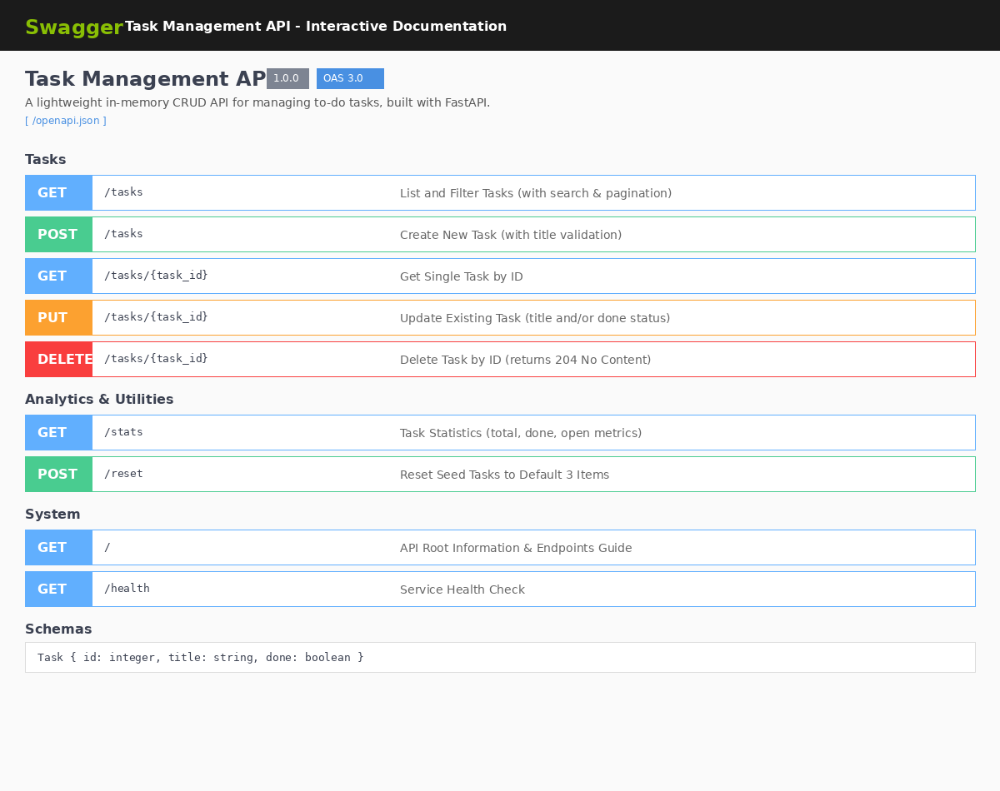

# FlyRank Backend Track · Week 2 · Assignment A1: Build Your First CRUD API (Python Lane)

A lightweight, production-structured in-memory RESTful CRUD API that manages a to-do list, built with **Python 3.11**, **FastAPI**, **Pydantic**, and **Swagger UI / OpenAPI 3.0**.

---

## 1. What This Is

This project fulfills the **FlyRank Internship Backend Track (Week 2, Assignment A1)**. It demonstrates the fundamental server-side HTTP request-response cycle by implementing the four core CRUD operations (**C**reate, **R**ead, **U**pdate, **D**elete) against an in-memory data store.

### Key Architectural Features
- **In-Memory Store**: Fast, self-contained list of task entities (no external database required).
- **Strict HTTP Status Semantics**:
  - `200 OK` for successful reads, updates, and stats.
  - `201 Created` for task creation with location receipt.
  - `204 No Content` for successful task deletion.
  - `400 Bad Request` for missing/empty required fields and validation errors.
  - `404 Not Found` for nonexistent task IDs with descriptive error JSON.
- **Interactive Swagger Documentation**: Built-in interactive OpenAPI explorer at `/docs`.
- **Production Enhancements & Stretch Goals**:
  - Full Query Filtering (`?done=true`, `?done=false`).
  - Search Query Filtering (`?search=term`).
  - Limit & Offset Pagination (`?limit=2&offset=1`).
  - Server Analytics Endpoint (`GET /stats`).
  - Demo Seed Restoration Endpoint (`POST /reset`).

---

## 2. How to Install and Run

### Prerequisites
- Python 3.10 or higher
- Git

### One Documented Command to Run
Clone the repository and start the server with auto-reload:

```bash
git clone https://github.com/your-username/crud-todo-api.git && cd crud-todo-api && pip install -r requirements.txt && uvicorn main:app --reload --port 8000
```

Once running, the server is live at:
- **API Base URL**: `http://localhost:8000`
- **Interactive Swagger UI**: `http://localhost:8000/docs`
- **OpenAPI Schema**: `http://localhost:8000/openapi.json`
- **Health Check**: `http://localhost:8000/health`

To execute the test suite:
```bash
python3 test_api.py
```

---

## 3. Endpoints Reference Table

| Method | Endpoint | Status Codes | Description | Request Body Example | Response Body Example |
| :--- | :--- | :--- | :--- | :--- | :--- |
| **GET** | `/` | `200` | API service discovery & root metadata | *None* | `{"name": "Task API", "version": "1.0", "endpoints": ["/tasks"]}` |
| **GET** | `/health` | `200` | Health check endpoint | *None* | `{"status": "ok"}` |
| **GET** | `/tasks` | `200` | List all tasks (supports `done`, `search`, `limit`, `offset`) | *None* | `[{"id": 1, "title": "Buy groceries", "done": false}, ...]` |
| **GET** | `/tasks/{id}` | `200`, `404` | Retrieve a single task by ID | *None* | `{"id": 1, "title": "Buy groceries", "done": false}` |
| **POST** | `/tasks` | `201`, `400` | Create a new task (auto-increment ID, `done=false`) | `{"title": "Buy milk"}` | `{"id": 4, "title": "Buy milk", "done": false}` |
| **PUT** | `/tasks/{id}` | `200`, `400`, `404` | Update title and/or done status | `{"title": "Updated", "done": true}` | `{"id": 1, "title": "Updated", "done": true}` |
| **DELETE** | `/tasks/{id}` | `204`, `404` | Remove task by ID | *None* | *Empty body* |
| **GET** | `/stats` | `200` | Compute task metrics | *None* | `{"total": 3, "done": 1, "open": 2}` |
| **POST** | `/reset` | `200` | Restore initial 3 example tasks | *None* | `{"message": "Tasks successfully reset...", "tasks": [...]}` |

---

## 4. Live `curl -i` Verification Outputs

### 4.1. List Tasks (`GET /tasks`)
```http
HTTP/1.1 200 OK
date: Mon, 12 Oct 2026 13:21:46 GMT
server: uvicorn
content-length: 152
content-type: application/json

[
  {"id": 1, "title": "Buy groceries", "done": false},
  {"id": 2, "title": "Read FastAPI documentation", "done": true},
  {"id": 3, "title": "Build CRUD API", "done": false}
]
```

### 4.2. Create Task (`POST /tasks`)
```bash
curl -i -X POST http://localhost:8000/tasks \
  -H "Content-Type: application/json" \
  -d '{"title": "Buy milk"}'
```
```http
HTTP/1.1 201 Created
date: Mon, 12 Oct 2026 13:21:47 GMT
server: uvicorn
content-length: 42
content-type: application/json

{"id": 4, "title": "Buy milk", "done": false}
```

### 4.3. Client Validation Error (`POST /tasks` with `{}`)
```bash
curl -i -X POST http://localhost:8000/tasks \
  -H "Content-Type: application/json" \
  -d '{}'
```
```http
HTTP/1.1 400 Bad Request
date: Mon, 12 Oct 2026 13:21:48 GMT
server: uvicorn
content-length: 46
content-type: application/json

{"error": "Validation error: field required"}
```

### 4.4. Not Found Error (`GET /tasks/99`)
```bash
curl -i http://localhost:8000/tasks/99
```
```http
HTTP/1.1 404 Not Found
date: Mon, 12 Oct 2026 13:21:49 GMT
server: uvicorn
content-length: 30
content-type: application/json

{"error": "Task 99 not found"}
```

### 4.5. Delete Task (`DELETE /tasks/4`)
```bash
curl -i -X DELETE http://localhost:8000/tasks/4
```
```http
HTTP/1.1 204 No Content
date: Mon, 12 Oct 2026 13:21:50 GMT
server: uvicorn
```

---

## 5. Interactive Swagger UI Documentation

FastAPI automatically parses route type annotations, Pydantic schemas, summaries, and docstrings to generate an interactive OpenAPI 3.0 specification served directly at `/docs`:



Developers can use the **Try it out** button in Swagger UI to test the complete CRUD lifecycle interactively without writing curl commands.

---

## 6. Stretch Goals: Deep Dives

### Why Real APIs Never Return "Everything" (Pagination)
In real-world applications, resources grow into thousands or millions of records. An unpaginated endpoint like `GET /tasks` or `GET /orders` creates catastrophic architectural risks:
1. **Memory Exhaustion (OOM)**: Loading millions of records into server memory causes high RAM pressure and crashes server processes.
2. **Network Bandwidth & Latency**: Sending massive payloads clogs the network pipe, multiplies latency, and slows down client devices (especially mobile).
3. **Database Query Starvation**: Full table scans lock tables or saturate database connection pools, degrading performance for all concurrent users.
4. **Denial of Service (DoS)**: An unpaginated API is an easy target for resource exhaustion attacks.

By supporting `GET /tasks?limit=2&offset=2`, clients retrieve data in predictable, discrete pages, ensuring consistent sub-10ms response times and constant memory usage.

### The Mortality Experiment
When new tasks are created during a running session and the server is restarted (`Ctrl+C` followed by `uvicorn main:app`), subsequent requests to `GET /tasks` reveal that all newly created tasks have disappeared, reverting back to the original 3 initial seed tasks. This occurs because the state was stored strictly in the volatile memory (RAM) allocated to the Python process, which is reclaimed by the operating system upon termination—a vivid demonstration of why persistent databases (SQL/NoSQL) and data migrations exist, setting the stage for Week 3.

---

## 7. Submission Checklist
- [x] Python 3.10+ FastAPI lane selected.
- [x] In-memory storage with 3 pre-filled tasks.
- [x] Full CRUD operations implemented: `GET /tasks`, `GET /tasks/{id}`, `POST /tasks`, `PUT /tasks/{id}`, `DELETE /tasks/{id}`.
- [x] Strict status codes: `200`, `201`, `204`, `400`, `404`.
- [x] Swagger UI active at `/docs` with detailed summaries and schemas.
- [x] Optional extras implemented: Query filtering, search, pagination, stats, and seed reset.
- [x] At least 6 commits across stages.
